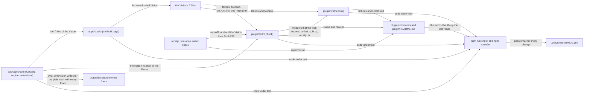

# CONNECTIONS — Frontend Focus: find and fix the current bugs

Form required by rules 7.2 and 9.3. An edge `A -->|label| B` means B depends on A: a change to A can break B.

## Graph

## Edge list

| From | To | Label | Broken when |
|---|---|---|---|
| packages/core | apps/studio | the 7 files of the Vision | a file that the Summary hands over differs from what `writeVision` returns for the stored project |
| apps/studio | the Vision's 7 files | the downloaded Vision | the archive does not unpack to exactly 7 files, or a file is empty or damaged |
| the Vision's 7 files | plugin/fit (Fit check) | tokens, Mockup, VISION.md, one fingerprint | the Fit check refuses a folder that the Studio wrote, or reads another fingerprint in 1 of the files |
| the Vision's 7 files | plugin/fit (the look) | tokens and Mockup | the look refuses a folder that the Studio wrote |
| plugin/fit (Fit check) | plugin/commands and plugin/README.md | status and receipt | a command or the guide states a status, an option or a file name that the program does not have |
| plugin/fit (the look) | plugin/commands and plugin/README.md | pictures and LOOK.md | the command names an option or a file that the look does not have |
| packages/core | plugin/fit (Fit check) | the edition number of the Floors | `FLOORS_EDITION` differs between `packages/core/src/catalog/floors.ts` and `plugin/fit/src/floors.ts` |
| npm run check and npm run e2e | .github/workflows/ci.yml | pass or fail for every change | the workflow runs a command that `package.json` does not define |
| packages/core | plugin/fit/trials/reference-floors | what `writeVision` writes for the plain start with every Floor | the freshness test in `plugin/fit/e2e/exit.e2e.ts` fails after a change of the Catalog or of the writer (repair: run that test once with `UPDATE_REFERENCE=1`) |
| plugin/fit (Fit check) | plugin/fit (the look) | modules that the look imports: `collect.ts`, `fit.ts` (`bounded`, `noBrowserLine`), `receipt.ts` (`fenceFor`) | a name that the look imports changes or leaves its module |
| plugin/commands and plugin/README.md | npm run check and npm run e2e | the words that the guide test reads | a change of wording in the guide or in a command that the test "has a guide that agrees with the programs ..." asserts |
| receipt.json of an earlier check | plugin/fit (Fit check) | `repairRound` and the Vision files' SHA-256 | the field names change, or the file is not the program's own (it is read as data) |
| receipt.json of an earlier check | plugin/commands and plugin/README.md | `repairRound` | `fit-repair.md` step 1 names a field that the receipt does not hold |
| packages/core | npm run check and npm run e2e | code under test | a test imports a name that the core no longer exports |
| apps/studio | npm run check and npm run e2e | code under test | a browser test names a button or a sentence that the screen no longer shows |
| plugin/fit (Fit check) | npm run check and npm run e2e | code under test | a stored trial receipt differs from what the program writes today |
| plugin/fit (the look) | npm run check and npm run e2e | code under test | `look.e2e.ts` fails |

## Nodes outside the DELIVERABLE

| Node | Kind | Version or date checked |
|---|---|---|
| Chromium at `/opt/pw-browsers/chromium` | library | used on 2026-11-21 (`evidence/capability-browser.txt`) |
| Playwright | library | 1.65.0 (`package.json`) |
| GitHub Actions workflow `ci.yml` | service | no failure reported on commit `52d1e73` (checked on 2026-11-22 through the pull request 24 notifications) |
| `refresh_reference.py` of the skill "living-reference" | script | run on 2026-11-22 on `docs/reference/guarantees.md`: "findings: none" (C6 rests on it) |
| `unzip` | program | used by `apps/studio/e2e/deliverable.e2e.ts` on 2026-11-22 (C3 rests on it) |
