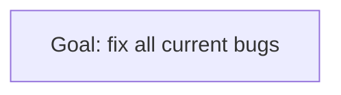

# MINDMAP — Frontend Focus: find and fix the current bugs

Form required by rule 9.2. Every CRITERION, WORK UNIT, decision and FINDING appears once, in both the list and the diagram.

## Hierarchy

- **Goal:** "Once possible, please run Hinshitsu and fix all current bugs, etc."
  - (no CRITERION yet; S4 writes them)

## Diagram

## Node check

| Kind | Count in `AUDIT-LOG.md` | Count in this map |
|---|---|---|
| CRITERIA | 0 | 0 |
| WORK UNITS | 0 | 0 |
| Decisions | 0 | 0 |
| FINDINGS | 0 | 0 |

<!-- from the log: start -->
Rebuilt by `scripts/hinshitsu_log.py state`. Do not edit between the marks.
- F-1 `hinshitsu/evidence/open-major-859c643.txt`, C1 (BLOCKER, FIXED by E-141)
- F-2 PLAN step 1, C1 state (a) for G-S05 (BLOCKER, FIXED by E-124)
- F-3 PLAN step 2, its test (BLOCKER, FIXED by E-73)
- F-4 C3, G11, A-9 (BLOCKER, FIXED by E-74)
- F-5 C1, PLAN step 7, A-9 (BLOCKER, FIXED by E-75)
- F-6 C4 and C7 (BLOCKER, FIXED by E-76)
- F-7 against C5 (BLOCKER, FIXED by E-77)
- F-8 C6 (BLOCKER, FIXED by E-78)
- F-9 C1 lists FTU-32 and G-T08 as inside the CRITERIA, and the closing sentence lists them as outside. (DEFECT, FIXED by E-79)
- F-10 C1 state (b) cannot hold for R-12 and FTU-22, and "exactly 1 of 2 states" cannot hold for R-S06. (DEFECT, FIXED by E-80)
- F-11 U7-02 is planned as closed in C1, optional in the plan, and excluded by PREMISE A-9. (DEFECT, FIXED by E-81)
- F-12 C1 requires a failing test for R-T06 and R-U05 in part; the plan names a reading, not a test, for R-T06. (DEFECT, FIXED by E-82)
- F-13 The translation table in the VOC points 6 rows at CRITERIA that do not say what the row says. (DEFECT, FIXED by E-142)
- F-14 C4 names 4 subjects and a test that covers 3, and the test checks the sum for 1. (DEFECT, FIXED by E-83)
- F-15 "A measure that counts" has no definition, in C4, in the guide, or in the command. (DEFECT, open)
- F-16 The summary line and the receipt count contrast in 2 units, and the receipt names the wrong unit. (DEFECT, open)
- F-17 The receipt says "0 not measured" for Floors where it checked nothing. (DEFECT, open)
- F-18 C5 counts "2 local commands" and names 3 things; "the Fit check's browser tests" has no command. (DEFECT, FIXED by E-84)
- F-19 C6's command holds a placeholder, and checks a file that C6 does not name. (DEFECT, FIXED by E-85)
- F-20 C7's test cannot compare statuses, and does not compare the 4 commands; "technical term" is not bounded. (DEFECT, FIXED by E-86)
- F-21 C3's test opens a different file from the one the CRITERIA call the built Studio page. (DEFECT, FIXED by E-87)
- F-22 C3 holds 5 phrases that a third party cannot test as written. (DEFECT, FIXED by E-88)
- F-23 C2 does not say what a test that "shows a finding false" looks like, and names no test. (DEFECT, FIXED by E-89)
- F-24 One thing has 3 names: "reference build", "clean build", "faithful build". (STYLE, FIXED by E-90)
- F-25 The plan's test column holds 3 vague terms. (STYLE, FIXED by E-91)
- F-26 `FRAMEWORK.md` says in section 1 that no CRITERIA entry exists, and at its end that  is the newest. (DEFECT, FIXED by E-92)
- F-27 The guide and the commands use "the program" for 2 programs, and "receipt" for the defined term "Honest receipt". (STYLE, open)
- F-28 Banned words: 2 occurrences. (STYLE, open)
- F-29 `hinshitsu/PLAN.md` line 12, Test cell of step 2 (DEFECT, FIXED by E-125)
- F-30 , C3 (line 847), the sentence on the published page (DEFECT, FIXED by E-126)
- F-31 , C4 (line 848) (DEFECT, FIXED by E-127)
- F-32 , C1, state (c), against `PLAN.md` line 21 (DEFECT, FIXED by E-128)
- F-33 , C1, the list "(b), a screen of the Studio, for the next run" (DEFECT, FIXED by E-129)
- F-34 , C1, FTU-21 in "(b), waits for an act of the owner" (DEFECT, FIXED by E-130)
- F-35 out-of-date sentences in the RUN FOLDER (DEFECT, FIXED by E-131)
- F-36 , C5 ("Each fix is 1 commit that holds its test and its record") against `PLAN.md` line 7 ("1 commit for each step") (DEFECT, FIXED by E-132)
- F-37 , C6 (line 850) (FRAGILITY, FIXED by E-133)
- F-38 , C3 and C5, the command `npx vitest run --config vitest.e2e.config.ts apps/studio/e2e/deliverable.e2e.ts` (FRAGILITY, FIXED by E-134)
- F-39 , C3: "(lines 18 to 20)" of `apps/studio/e2e/deliverable.e2e.ts` (FRAGILITY, FIXED by E-135)
- F-40 , C6: "`SPEC.md` sections 2.28 to 2.30" (FRAGILITY, FIXED by E-136)
- F-41 , C7, the list of 13 terms (STYLE, FIXED by E-137)
- F-42 3 loose statements (STYLE, FIXED by E-138)
- F-43 , C4, the clause "a Vision of an edition of the Floors that the program does not read gives no count \"not measured\" for its Floor requirements (row R-U03)". (BLOCKER, FIXED by E-143)
- F-44 , C5, first sentence; and the line "Translation, 1 line changed". (BLOCKER, FIXED by E-144)
- F-45 , C1, the list "(b), the project's own tests, Catalog data and GitHub's check, for the next run, on the same word: X-02, CR-GX2, C-07, A1-09". (BLOCKER, FIXED by E-145)
- F-46 , C3, the sentence on the Summary. (BLOCKER, FIXED by E-146)
- F-47 , C4, "1 reference build (the Vision's own page of trial 001 … this Vision writes no Floor …)". (BLOCKER, FIXED by E-147)
- F-48 , C1, "G-S05 (… kept for width and height conditions, on the USER's word in )". (BLOCKER, FIXED by E-148)
- F-49 , C1, state (c), third reason, and the Test sentence. (BLOCKER, FIXED by E-149)
- F-50 , C6, "(… on a machine without that skill this part of the test is reported UNVERIFIED)". (BLOCKER, FIXED by E-150)
- F-51 , C7, "and `plugin/commands/fit-check.md` does too"; and steps 10 and 11 of `PLAN.md`. (BLOCKER, FIXED by E-151)
- F-52 , C1, "Each of the 49 rows"; , question 1 (a) ("my search missed 5"). (BLOCKER, FIXED by E-152)
- F-53 , C1, "(b), repaired in part by this run: G-S05 … and R-S06". (BLOCKER, FIXED by E-153)
- F-54 , C1, the lists "(b), a limit that the receipt states" (G-S11, G-S10) and "(b), repaired in part before this run, the kept part a limit that the receipt states" (R-S04, and 1 rest of R-S06). (BLOCKER, FIXED by E-345)
- F-55 , C4: "status 0 goes only with \"No deviation\" and with 0 \"not measured\" in a measure that counts", "Contrast only where the Vision writes Floor A1", and the fifth case "checked against its own `mockup.html`". (DEFECT, FIXED by E-371)
- F-56 `plugin/fit/src/fit.ts` lines 519 to 524. (DEFECT, open)
- F-57 `redteam/FINDINGS.md` lines 642 (A2-J3), 687 (G-S09), 401 (S6-01, grade blocker), 194 (T2-05); C1, the sentence on rows outside the list. (DEFECT, open)
- F-58 , C1: "The list is the rows whose Status holds 1 of the 13 phrases of that script, and the 4 named". (DEFECT, open)
- F-59 , C1, the list "(b), a screen of the Studio, for the next run, on the USER's word in , answer 2". (DEFECT, open)
- F-60 , C1, Test: "the 2 readers named above report on R-T06 and G-U07". (FRAGILITY, open)
- F-61 , C5: "The fixes of this run, 1 commit each: …" and "the last lines of the 3 outputs are saved". (FRAGILITY, open)
- F-62 `hinshitsu/PLAN.md` line 40 and line 18. (DEFECT, open)
- F-63 , C1: "M-01, R23-01, T6-08, P9-05, FTU-21, G-T08, each with the act as  names it", under the heading "The full new text of each changed CRITERION". (STYLE, open)
- F-64 `kite/plugin/fit/src/cli.ts`, line 115: `repairRound > 1` (BLOCKER, WITHDRAWN by E-283)
- F-65 `packages/core/src/tokens.ts`, line 575 (`out['--font-numeric'] = p.numerals === 'mono' ? FONTS['jetbrains-mono'].stack : 'inherit';`); in the handed-over Vision: `tokens.css` line 91, `--font-numeric: inherit;` (also `plugin/fit/trials/reference-floors/tokens.css` line 91) (BLOCKER, FIXED by E-313)
- F-66 `apps/studio/e2e/deliverable.e2e.ts`, lines 108 to 124 and 127 to 147 (DEFECT, FIXED by E-314)
- F-67 `plugin/fit/src/collect.ts`, `cutAway`, lines 416 and 418 (the fix of the automatic reviewer's finding 1, commit 5f6d8c2) (DEFECT, FIXED by E-346)
- F-68 `plugin/fit/src/collect.ts`, `mediaConditions`, line 572 (`clean.slice(0, 200)`), line 574 (`budget = 20000`), line 596 (`at < 2000`), line 598 (`.slice(0, 400)`) (DEFECT, FIXED by E-347)
- F-69 `plugin/fit/src/fit.ts`, `sameAsGround`, line 360 (`own.length * 2 >= wanted.length`) (DEFECT, FIXED by E-348)
- F-70 `plugin/fit/src/collect.ts`, lines 307, 312 and 316 (`el.ownerSVGElement`, `picture.querySelector(...)`, `up !== picture`) (DEFECT, FIXED by E-349)
- F-71 `plugin/fit/src/fit.ts`, line 575 (the hash of `input.files[name]`, a decoded text); `plugin/fit/src/cli.ts`, line 80 (`readFileSync(path, 'utf8')`) (DEFECT, FIXED by E-350)
- F-72 `plugin/fit/src/cli.ts`, lines 50 to 64 and 115; `plugin/fit/src/receipt.ts`, lines 142 to 144; `plugin/fit/src/fit.ts`, line 583 (DEFECT, FIXED by E-351)
- F-73 `plugin/fit/src/receipt.ts`, lines 126, 127 and 132 (`headOf`); `plugin/fit/src/cli.ts`, line 146 (DEFECT, FIXED by E-352)
- F-74 `plugin/fit/src/fit.ts`, line 573 (the status rule); `plugin/fit/e2e/exit.e2e.ts`, lines 704 to 707 (FRAGILITY, FIXED by E-315)
- F-75 `plugin/fit/src/fit.ts`, lines 461 and 468 (`unreadTexts.add(text.where)`, `belowTexts.add(text.where)`), and line 528 (DEFECT, open)
- F-76 `plugin/fit/src/fit.ts`, lines 607 to 611 (`noBrowserLine`, the pattern `browserType\.launch|Executable doesn't exist|Failed to launch`) (FRAGILITY, FIXED by E-353)
- F-77 `redteam/FINDINGS.md`, rows FTU-33 and FTU-35, Status (STYLE, FIXED by E-316)
- F-78 `plugin/fit/e2e/exit.e2e.ts` lines 512, 513, 671, 732 (FRAGILITY, FIXED by E-354)
- F-79 `plugin/fit/src/collect.ts` lines 400, 442, 561; `plugin/fit/src/look.ts` line 1245; `plugin/fit/src/fit.ts` lines 398-399 (STYLE, open)
- F-80 `plugin/fit/src/cli.ts` lines 44 and 66-84; `plugin/fit/src/look-cli.ts` lines 38 and 40-59 (STYLE, open)
- F-81 `plugin/fit/src/cli.ts` lines 1 and 10; `plugin/fit/src/look-cli.ts` lines 1 and 11; `plugin/commands/fit-build.md`, `fit-check.md`, `fit-look.md`, `fit-repair.md` line 3 (and `fit-repair.md` lines 9, 15; `fit-build.md` line 14; `fit-look.md` line 11); against `plugin/README.md` (STYLE, FIXED by E-317)
- F-82 `plugin/commands/fit-repair.md` line 12 (step 2) (STYLE, FIXED by E-318)
- F-83 `plugin/fit/trials/002/RECORD.md` lines 74-80 (STYLE, open)
- F-84 `plugin/fit/src/collect.ts` line 404 (STYLE, FIXED by E-355)
- F-85 `plugin/fit/src/fit.ts` line 614 (STYLE, FIXED by E-356)
- F-86 `plugin/fit/src/floors.ts` lines 88-90; `plugin/fit/src/fit.ts` lines 567 and 651-662; `plugin/fit/src/look.ts` line 1247; folder `plugin/fit/trials/reference-floors/` (STYLE, open)
- F-87 `plugin/fit/src/cli.ts` lines 142 and 149; `plugin/fit/src/receipt.ts` line 78; `plugin/fit/src/look.ts` line 1147 (STYLE, open)
- F-88 `plugin/fit/src/fit.ts` lines 607 to 610 (`noBrowserLine`), used at `plugin/fit/src/cli.ts` line 166 and `plugin/fit/src/look-cli.ts` line 154; the test at `plugin/fit/e2e/exit.e2e.ts` line 320 (DEFECT, FIXED by E-357)
- F-89 `plugin/fit/e2e/look.e2e.ts` lines 533 and 547 (`expect(pipe.took).toBeLessThan(5000)`, `expect(visionPipe.took).toBeLessThan(5000)`), and line 555 (`toBeLessThan(40_000)`) (FRAGILITY, open)
- F-90 `packages/core/test/engine.test.ts` (tests "chooses an Option with an overused-look warning rarely when it composes Directions" and "never offers a generated Direction whose own choices pull against each other, over 60 seeds (decision D23)") and `packages/core/test/project-file.test.ts` (test "brings a design value that no slider and no Option can set into reach, and says so (campaign 4, round 3)"); root `vitest` settings (default limit of 5,000 ms per test) (FRAGILITY, open)
- F-91 4 comments that the unit's insertions parted from the code they describe: `plugin/fit/src/collect.ts` line 561 (the doc comment of `readBrief` now stands above the doc comment of `mediaConditions`; `readBrief` at line 601 has none); `plugin/fit/src/look.ts` line 1245 (the doc comment of `typefaceNames` stands above `nameShown`; `typefaceNames` at line 1253 has none); `plugin/fit/src/collect.ts` line 442 (the comment of `covered`/`coveredInPlace` stands above `scrollBoxes`); `plugin/fit/src/fit.ts` lines 398 to 399 (the comment on unread settings, finding G-S05, stands above the closed-shadow-root lines of finding A2-V4) (STYLE, open)
- F-92 `plugin/fit/src/cli.ts` line 10 and `plugin/fit/src/look-cli.ts` line 11 (`USAGE`: "<folder of the Vision files>", path `plugin/fit/src/...`); `plugin/commands/fit-check.md` lines 3 and 9 and `fit-repair.md` lines 3 and 9 (both changed in this unit; "folder of the Vision", "the folder that holds the Vision's files"); also `fit-build.md` and `fit-look.md`; against `plugin/README.md`, which says "Vision folder" each time and prints the 2 usage lines as `node fit/src/cli.ts ... <Vision folder> ...` (STYLE, FIXED by E-319)
- F-93 `plugin/fit/src/fit.ts` line 543 (`failed + (otherEdition ? 1 : ...)`), `plugin/fit/src/cli.ts` line 146 (`- (noneCheckedOf === undefined ? 0 : 1)`), `plugin/fit/src/receipt.ts` line 127 (`m.notMeasured - 1`) (STYLE, open)
- F-94 `plugin/fit/e2e/look.e2e.ts` line 542: `spawnSync('rm', [join(visionFolder, 'tokens.css')]);` (STYLE, FIXED by E-358)
- F-95 `SPEC.md` section 2.31 (13 points) and `feature_list.json` (last entry F038, for section 2.25) (STYLE, open)
- F-96 `KITE/plugin/fit/src/cli.ts` line 115: `const lastRoundVision = repairRound > 1 ? lastVision(...) : undefined;` (MOSS and commit 52d1e73: `repairRound > 0`) (BLOCKER, WITHDRAWN by E-284)
- F-97 `plugin/fit/src/fit.ts` lines 348-363 (`sameAsGround`) and 372-382 (`contrastOf`); `collect.ts` lines 355-371 (DEFECT, FIXED by E-359)
- F-98 `plugin/fit/src/collect.ts` lines 404-423 (`cutAway`, the branch for a box that scrolls) (DEFECT, FIXED by E-360)
- F-99 `plugin/fit/src/collect.ts` lines 568-599 (`mediaConditions`: `slice(0, 200)`, `budget = 20000`, `slice(0, 400)`, no walk into the sheet of an `@import` rule); `plugin/fit/src/fit.ts` lines 635-649 (`unreadConditions`: `known.has(condition)`) (DEFECT, open)
- F-100 `plugin/fit/src/fit.ts` lines 614-626 (`countClosedRoots`: `at < 200_000`, breadth-first) (DEFECT, FIXED by E-361)
- F-101 `plugin/fit/src/collect.ts` lines 272-287 (the `use` branch: fill and stroke only, the first 200 shapes, no nested `use`) and lines 283-291, 305-308 (a paint that begins with `url(` is skipped whole) (DEFECT, FIXED by E-362)
- F-102 `plugin/fit/src/collect.ts` lines 292-298 (the corner of an SVG rectangle is taken in the picture's own units) (DEFECT, FIXED by E-363)
- F-103 `plugin/fit/src/collect.ts` line 263 (`fieldText`) (DEFECT, FIXED by E-364)
- F-104 `plugin/fit/src/look-cli.ts` lines 82-90 (`findFonts`: `statSync` without `isFile()`, then `readFileSync`) (DEFECT, FIXED by E-365)
- F-105 `plugin/fit/src/fit.ts` line 575 (the hash is taken over the decoded text, written back as UTF-8); `cli.ts` line 80 (`readFileSync(path, 'utf8')`); `receipt.ts` lines 39-42 ("each by the SHA-256 of its bytes") (DEFECT, FIXED by E-366)
- F-106 `plugin/fit/src/floors.ts` lines 97-104 (`labelled`) (DEFECT, FIXED by E-367)
- F-107 `plugin/fit/src/floors.ts` lines 186-192 (`writtenFloorIds`) and `fit.ts` line 519 (`otherEdition = written.length > 0 && edition !== FLOORS_EDITION`) (FRAGILITY, open)
- F-108 `plugin/fit/src/cli.ts` lines 50-64 and 113-116 (the comparison rests on `receipt.json` in the result folder, which the repair command may write and which a refused run deletes) (FRAGILITY, open)
- F-109 `plugin/fit/src/cli.ts` lines 146 and 153; `fit.ts` lines 126-131 (STYLE, open)
- F-110 `plugin/fit/src/look.ts` line 1219 (the family enters `look.json` as written) against lines 1246-1251 (`nameShown`, used for `LOOK.md` only) (FRAGILITY, open)
- F-111 `plugin/commands/fit-check.md` step 1 (`node "${CLAUDE_PLUGIN_ROOT}/fit/src/cli.ts" $ARGUMENTS`); `plugin/fit/src/cli.ts` line 10 and `look-cli.ts` line 11 (the usage lines name `plugin/fit/src/…`, the guide names `fit/src/…`) (FRAGILITY, open)
- F-112 `plugin/fit/src/fit.ts` lines 568-573; `plugin/README.md` lines 58 and 62 (DEFECT, FIXED by E-320)
- F-113 the downloaded `tokens.css` line 91, `--font-numeric: inherit;` (also `tokens.json` line 849, and line 91 of `tokens.css` in `plugin/fit/trials/001`, `002`, `003` and `reference-floors`). Source: `packages/core/src/tokens.ts:575`, `out['--font-numeric'] = p.numerals === 'mono' ? FONTS['jetbrains-mono'].stack : 'inherit';` (BLOCKER, FIXED by E-321)
- F-114 `apps/studio/e2e/deliverable.e2e.ts` line 145, `expect(facts.text).toContain('</style> & more')`, where `facts.text` is `document.body.innerText` (FRAGILITY, FIXED by E-322)
- F-115 the usage line of `plugin/fit/src/cli.ts` and of `plugin/fit/src/look-cli.ts` (DEFECT, FIXED by E-368)
- F-116 the refusal message of both programs for a missing Vision file (STYLE, FIXED by E-369)
- F-117 `LOOK.md`, heading "What the pictures do not show", third bullet: "...or in dark mode (finding G-S05)." (STYLE, FIXED by E-370)
- F-118 the downloaded `VISION.md`: line 14 ("check that you have all seven files and that each carries the fingerprint below") and line 29 (STYLE, FIXED by E-323)
- F-119 `plugin/README.md`, "How to load the plugin": "the folder passed Claude Code's own check of a plugin's form, `claude plugin validate`, with one remark: it has no install line for a marketplace." (FRAGILITY, open)
- F-120 `plugin/README.md`, table "What the Fit check's status means", row 2: "(a file is missing, the files do not belong together, the repair budget is spent)" (STYLE, FIXED by E-324)
- F-121 `SPEC.md` line 481, section 2.29, point 3: "No test with a listener proves this yet." (BLOCKER, FIXED by E-325)
- F-122 `SPEC.md` line 489, section 2.29: "Open, each a row of `redteam/FINDINGS.md`: 5 major findings (R-S08, R-S09, R-S11, R-T06 in part, R-U05 in part) and the minor ones." (BLOCKER, FIXED by E-326)
- F-123 `docs/reference/guarantees.md` lines 962-964, section 66.10 (BLOCKER, FIXED by E-327)
- F-124 `PROGRESS.md` line 28 ("Start here", traps): "Four links in the top bar do not fit a 320-pixel window side by side"; line 820 ("Known gaps"): "Top bar on a 320-pixel window. Its four links wrap onto two rows." (BLOCKER, FIXED by E-328)
- F-125 `PROGRESS.md` line 34 ("Start here"): "`WAYPOINTS.md` holds the address and the version of each waypoint (its newest rows are W15 and W16…)" (BLOCKER, FIXED by E-329)
- F-126 `hinshitsu/FRAMEWORK.md` lines 22, 25, 58; `hinshitsu/CONNECTIONS.md` line 46 (DEFECT, open)
- F-127 `hinshitsu/PLAN.md`, table rows 4, 6, 7, 9, 11, 18 and line 41 (DEFECT, FIXED by E-330)
- F-128 `hinshitsu/CONNECTIONS.md`, graph and edge list (DEFECT, FIXED by E-331)
- F-129 `hinshitsu/FRAMEWORK.md` section 5 (DEFECT, FIXED by E-332)
- F-130 `SPEC.md` section 2.31 (line 508 and points 1 to 13) (DEFECT, FIXED by E-333)
- F-131 `plugin/fit/trials/reference-floors/README.md` line 13: "the receipt shows Floor deviations and status 1; that is expected, and the guarantees reference says why (section 66.11)." (DEFECT, FIXED by E-334)
- F-132 commits 5f6d8c2, 7b25baa, 3947494 against `SPEC.md` 2.31 points 1 to 3 (STYLE, open)
- F-133 `plugin/README.md` ("the Vision folder"); `plugin/commands/*.md` argument hints and steps ("folder of the Vision"); `cli.ts:10` and `look-cli.ts:11` ("folder of the Vision files"); `cli.ts:1` ("folder of the Vision's files") (STYLE, open)
- F-134 `hinshitsu/FRAMEWORK.md` section 6 and `hinshitsu/PLAN.md` ("WORK UNITS") (DEFECT, FIXED by E-335)
- F-135 `packages/core/test/project-file.test.ts:180`, "brings a design value that no slider and no Option can set into reach, and says so (campaign 4, round 3)"; `vitest.config.ts` sets no time limit, so 5,000 ms applies. The work unit did not change this file (last change: b780778) (FRAGILITY, open)
- F-136 `plugin/fit/trials/003/RECORD.md` (BLOCKER, FIXED by E-336)
- F-137 `PROGRESS.md` line 820 ("Top bar on a 320-pixel window. Its four links wrap onto two rows.") and line 28 ("Four links in the top bar do not fit ..."); against line 809 of the same part ("The top bar now holds five links") and `apps/studio/src/App.tsx` lines 187-191, which hold 5 links (BLOCKER, FIXED by E-337)
- F-138 `plugin/README.md` lines 59 and 64-67; `plugin/commands/fit-check.md` line 14 (DEFECT, FIXED by E-338)
- F-139 `plugin/commands/fit-build.md` line 15 (DEFECT, FIXED by E-339)
- F-140 `plugin/commands/fit-repair.md` line 12 (DEFECT, FIXED by E-340)
- F-141 `plugin/README.md` lines 58 and 62; `plugin/commands/fit-check.md` lines 12-13; against `SPEC.md` line 522 (section 2.31, point 12) and `trials/003/RECEIPT.md` line 49 (DEFECT, FIXED by E-341)
- F-142 `SPEC.md` line 522; `receipt.ts` line 128 ("N deviations; N not measured."); `cli.ts` line 153 ("N things could not be measured") (DEFECT, open)
- F-143 `redteam/FINDINGS.md`, the state sentences of 18 Studio rows (lines 36, 110, 121, 129, 134, 135, 136, 138, 169, 171, 175, 214, 269, 293, 366, 370, 490, 773) (DEFECT, FIXED by E-342)
- F-144 `redteam/FINDINGS.md` line 397 (P9-05): "The act: a second reader (...)" has no verb and no actor's act; "Known gaps" line 801 asks "Who reads the craft rules, the Vision's writer and the Summary's sections as a second reader?", where "the Vision's writer" can be read as a person. Line 387 (H7-01): "Who must act: nobody unless the owner changes that choice; the row is listed with the Studio's screens for the next run" gives two answers. Line 683 (G-S05): "the builder, with the work on more window widths" names no run and no date. Lines 629, 682, 688, 689: "Reason: it needs a person's eye or another design of the tool" leaves the reason open by "or"; lines 65, 78, 306, 443, 633 do the same with "its Catalog data or GitHub's check" (STYLE, open)
- F-145 `PROGRESS.md` line 40, in "Start here": "**What the next session should do first.**" (STYLE, FIXED by E-343)
- F-146 `trials/003/RECEIPT.md` lines 5, 69 and 100; `receipt.ts` line 139; `fit.ts` line 582 (STYLE, open)
- F-147 `receipt.ts` line 138; line 3 of each receipt (STYLE, open)
- F-148 The contrast limit: "the usual least" (`receipt.ts` 129), "the least" (129), "the usual contrast" (`cli.ts` 157), "the least contrast" (`cli.ts` 152). A receipt with 0 such lines (001, line 49) never says that the usual least is 4.5 to 1. - The fingerprint: "Fingerprint of the Vision that this receipt measured against" (receipt) and "Fingerprint of the design values" (`LOOK.md`). Receipts 001 and 003 show the same fingerprint `7776d35d` for two Visions whose `VISION.md` differ. - "Floor": the 5 Floors of `CLAUDE.md`, and one requirement ("Floor A1" in README line 62, `fit-check.md` line 12, the receipts); README line 88 says "requirement A2". Receipt 003 line 100: "The Floors of the Vision. The program checked none of them: A1, A2, ...". C4 itself writes "Floor A1". - The folder: "Vision folder" (guide), "folder of the Vision" (argument hints and commands of all 4 command files), "folder of the Vision files" (both usage lines), "The folder" (`vision.ts` line 90, command 8 above, which does not say which of the 2 folders). - The summary line: "the Fit check's one line" (guide), "the program's one line" (commands, `SPEC.md`), "summary line" (C4, the test's title). - "Program": README line 14 calls Node "the program", lines 5 and 15 call the Fit check and the look "the two programs". - Status 2: the guide's tables say "refused"; the no-browser message says "stopped". README line 60 lists 3 causes in brackets; the usage line, a link in the result folder, a file over 20 megabytes (STYLE, open)
- F-149 README line 100: "The receipt shows at most 20 of them, apart from what the Fit check measured". "Apart from" reads as "separately from" or as "besides". - README line 87: "... and requests to other sites with the Vision, at 375, 768, and 1280 pixels": "with the Vision" hangs on "sites"; "pixels" of what is not said (`fit-check.md` line 7 and `fit-look.md` line 7 too). - README line 49: "Claude repairs the smallest thing for each deviation" (the command says "make the smallest change"). - Receipts, Requests block (`fit.ts` line 536): "the page also counts when its markup or style sheets name another site" (counts as what). - Receipts, Contrast block: "A person must judge these by eye: The lines below may quote the page" (a colon, then a new sentence). - `look-cli.ts` line 146: with 1 failure the line reads "1 window widths not pictured". - `FINDINGS.md` line 827 (R-S06): "a gradient or an inset shadow on every element" (STYLE, open)
- F-150 the receipts use "SHA-256", "pseudo-elements", "@font-face rule", "clip-path", "mask", "media condition", "shadow root", "iframe", "blend mode" and "WCAG 2.x formula" with no meaning at first use; the guide explains only the first ("checksum"). The receipt's Content title and `LOOK.md` line 68 say "the Brief"; the guide never uses or explains that term (it says "as the Mockup shows them"). `LOOK.md` line 76 ends "(finding G-S05)", a row of `redteam/FINDINGS.md`, which is not in `plugin/`. The VOC () says the owner is not a programmer and reads every receipt (STYLE, open)
- F-151 `plugin/fit/trials/002/RECORD.md` lines 13-17 (table) against lines 22, 24 and 26 (DEFECT, FIXED by E-344)
- F-152 `plugin/README.md` line 39 ("on 2026-11-22, under a newer version of that check, with a second remark, that the plugin has no icon"); `docs/reference/guarantees.md` §66.10 Exceptions ("passed it with two remarks") and the change-log line of v1.29; repeated in the build log of commit 20. (BLOCKER, open)
- F-153 `plugin/fit/trials/002/RECORD.md` line 84 ("each of its 3 rounded rectangles has another corner at each of the 3 window widths", then "the 12 values"); lines 76 and 80 ("the Corner radii row of the table shows 3", "The table above shows the new number"). (DEFECT, open)
- F-154 `plugin/commands/fit-repair.md` lines 11 to 15. (DEFECT, open)
- F-155 `fit-check.md` step 3; `fit-build.md` step 5, first sentence; `fit-look.md` step 1 and steps 2 to 4. (DEFECT, open)
- F-156 line 9 ("Start here"): 'each repair has an entry in the build log below ("repair run, commit 1" to "commit 19")'; line 126 (build log, commit 20): "the guide and the 4 commands state 3 cases of status 1". (DEFECT, open)
- F-157 see the report, new finding 6 (DEFECT, open)
- F-158 section 2.29, "each row of `redteam/FINDINGS.md` names its test"; section 2.31 point 15, "Under each measure the receipt says how many causes left the page, or a part of it, unread". (DEFECT, open)
- F-159 `apps/studio/e2e/deliverable.e2e.ts` lines 132-134 and 187; `plugin/fit/e2e/exit.e2e.ts:257`. (FRAGILITY, open)
- F-160 `plugin/README.md`. (STYLE, open)
- F-161 `003/RECORD.md` line 11 (the mark names the change of names only); `001/RECORD.md` "Instruction" ("a folder that held the seven files in `files/`"); the helpers' pages `001/index.html` and `003/index.html`. (STYLE, open)
- F-162 C1 in , list "(b), repaired in part by this run: G-S05 (repaired for media conditions other than width and height; kept for width and height conditions, on the USER's word in  …)"; `redteam/FINDINGS.md` row G-S05; `plugin/fit/src/receipt.ts` `STILL_NEEDS_A_PERSON`, the entry "Dark mode, touch screens …". (BLOCKER, open)
- F-163 `plugin/fit/src/collect.ts`, `cutAway`, the 2 new lines `if (Math.min(to, …) - Math.max(from, …) < 1) return true;`. (DEFECT, open)
- F-164 `collect.ts`, `paints`, `placed.getScreenCTM()` where `placed` is the `use`. (DEFECT, open)
- F-165 `collect.ts` (`ordinal`, the field `n`); `fit.ts`, `textKey`. (DEFECT, open)
- F-166 `collect.ts`, the building of `shownLines`. (DEFECT, open)
- F-167 `collect.ts`, `paints`, `getScreenCTM`. (FRAGILITY, open)
- F-168 `fit.ts`, the sentence around an unread condition, with `PAST_LIMIT` of `collect.ts`. (STYLE, open)
- F-169 `fit.ts`, `noBrowserLine`. (STYLE, open)
<!-- from the log: end -->
