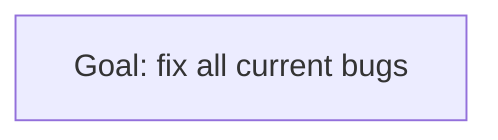

# MINDMAP — Frontend Focus: find and fix the current bugs

Form required by rule 9.2. Every CRITERION, WORK UNIT, decision and FINDING appears once, in both the list and the diagram.

## Hierarchy

- **Goal:** "Once possible, please run Hinshitsu and fix all current bugs, etc."
  - (no CRITERION yet; S4 writes them)

## Diagram

## Node check

| Kind | Count in `AUDIT-LOG.md` | Count in this map |
|---|---|---|
| CRITERIA | 0 | 0 |
| WORK UNITS | 0 | 0 |
| Decisions | 0 | 0 |
| FINDINGS | 0 | 0 |
